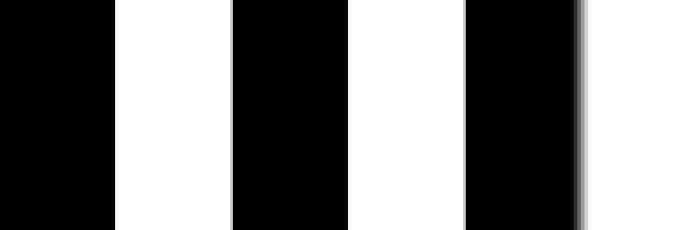

# 复合变换下采样核的面积守恒：雅可比、长短轴反解与灰雾审计

对应题目：**先旋转 45° 再缩到一半，边缘出现一层灰雾**；采样核在复合变换下
面积被改变、被拉长又压扁。本文写出复合变换的雅可比，按面积守恒反解核的长短轴，
给出轴比失配时的误差上界，并用三组变换组合对照核面积与边缘灰度差、按像素统计灰雾面积。

所有数字都由代码实算、被 `kernel/kernel_test.go` 钉住，可复现：

```bash
go run ./cmd/kernelreport     # 生成 artifacts/kernel_report.json、KERNEL_REPORT.md、PGM/PNG
go test ./kernel/             # 校验下列全部数值与“实测落在界内”
```



---

## 1. 复合变换的雅可比（四个分量）

变换顺序是“先旋转 θ，再按 `(sx,sy)` 缩放”，所以缩放矩阵在左：

\[
x'=\operatorname{diag}(s_x,s_y)\,R(\theta)\,x,\qquad
J=\begin{pmatrix}s_x\cos\theta&-s_x\sin\theta\\ s_y\sin\theta&s_y\cos\theta\end{pmatrix}
=\begin{pmatrix}a&b\\c&d\end{pmatrix}.
\]

题目主场景 θ=45°、`sx=sy=0.5`：

\[
J=\begin{pmatrix}
0.353553&-0.353553\\
0.353553& 0.353553
\end{pmatrix},\qquad
\det J=0.25.
\]

`det J` 就是面积缩放率：模型空间的面积到屏幕空间缩到 0.25。反过来，一个输出像素
的单位足迹用 \(J^{-1}\) 投影回模型空间时，面积因子是 \(1/\det J=4\)——核被放大到
4 倍。若直接拿这个未归一化的足迹当采样核，核过宽，直边两侧就被抹出一层灰雾
（实测 18 档偏差、128 个灰雾像素，见下）。

雅可比的两个奇异值 \(\sigma_{\max},\sigma_{\min}\)（即 \(J^\top J\) 特征值开根）
决定椭圆足迹的长短轴，轴比

\[
\kappa=\sigma_{\max}/\sigma_{\min}
\]

就是“拉长 / 压扁”的程度；长轴朝向

\[
\phi=\tfrac12\operatorname{atan2}(2g_{01},\,g_{00}-g_{11}).
\]

主场景是均匀缩放，奇异值都是 0.5，\(\kappa=1\)（只变大、不扁）；而非均匀
`(sx,sy)=(0.5,1)` 加 45° 旋转时，奇异值为 `(1, 0.5)`、\(\kappa=2\)，
原始逆足迹轴为 `(2,1)`，这才真正“又长又扁”。

## 2. 按面积守恒反解长短轴（核面积 = 1）

设椭圆核长、短半轴为 \(a,b\)，要求轴比等于雅可比条件数 \(a/b=\kappa\)，
并要求核的几何面积等于一：

\[
\pi ab=1.
\]

联立解得

\[
\boxed{a=\sqrt{\kappa/\pi},\qquad b=1/\sqrt{\pi\kappa}}
\]

恒有 \(a/b=\kappa\)、\(\pi ab=1\)。代码：`kernel.ConservedEllipse`。

另一种常见约定把雅可比“面积因子” \(ab\) 直接当作核面积并要求 \(ab=1\)，此时
\(a=\sqrt\kappa,\ b=1/\sqrt\kappa\)（`ConservedAxesProduct`）。两种约定只差
公共缩放 \(1/\sqrt\pi\)，轴比、朝向和灰度结论完全一致；报告把 \(ab\) 与 \(\pi ab\)
两列都列出，便于复算。

## 3. 可审计的直边灰雾模型

题目没有指定核形与边缘场景，这里采用一个解析、确定、可逐像素复算的模型：

- 64×64 图，x=31.5 处一条竖直黑白直边（左 0 右 255）；
- 均匀椭圆核与直边的覆盖率有解析解：把椭圆沿长短轴仿射成单位圆后，

\[
\text{覆盖率}=q(h)=\frac{\arccos h-h\sqrt{1-h^2}}{\pi},\quad h=-d/w,
\]

其中 \(w=\sqrt{a^2\cos^2(\phi-\alpha)+b^2\sin^2(\phi-\alpha)}\) 是核沿边缘法线的
支撑半径；像素值四舍五入到 uint8。没有随机采样噪声。

**“边缘两侧灰度差”**定义为距边 1.5 px 的两侧平台探测列，相对纯黑/纯白的最大偏差
\(\max(g_{\text{dark}},\,255-g_{\text{bright}})\)（档位 0–255）。紧邻边缘的两列
（距离 0.5 px）是正常抗锯齿过渡，不计入“两侧平台”。

**灰雾像素**定义为：在正常抗锯齿边对（\(|d|<1\) px）之外，却仍偏离本侧纯色
**超过 2 档**的像素。这样“两档以内”与灰雾阈值用的是同一把尺。

## 4. 三组变换组合：核面积 × 灰度差 × 灰雾面积

| 组 | 变换 | detJ | κ | 用轴 (a,b) | 核面积 πab | 边缘最大灰度差(档) | 灰雾像素(px) | 守恒? |
|---|---|---:|---:|---|---:|---:|---:|:--:|
| **G1** | 恒等 0°/1× | 1 | 1 | (0.5642, 0.5642) | 1.000000 | **0（≤2）** | **0** | ✓ |
| **G2** | 转45°再缩一半·守恒核（修复） | 0.25 | 1 | (0.5642, 0.5642) | 1.000000 | **0（≤2）** | **0** | ✓ |
| **G3** | 转45°并非均匀缩 + 错长轴（负对照） | 0.5 | 2 | (3.9894, 0.3989) | 5.000000 | **46** | **256** | ✗ |

- G1、G2 面积严格为 1（浮点残差 1.1e-16），两侧平台实测就是纯 0 与纯 255，
  灰度差 0 档 ≤ 2，灰雾 0 像素——**改完灰雾消失**。
- G3 是故意构造的守恒失败组：在 κ=2 的各向异性变换上，只把长轴违规放大到守恒解的
  5 倍、短轴不动，于是核面积变成 5、灰度差 46 档、灰雾 256 px。

题目主场景的**修复前 → 修复后**：

| | 轴 | 面积因子 | 边缘最大灰度差 | 灰雾像素 |
|---|---|---:|---:|---:|
| 修复前（直接用 J⁻¹ 足迹） | (2, 2) | ab=4=1/detJ | 18 档 | 128 px |
| 修复后（面积守恒反解） | (0.56419, 0.56419) | πab=1 | **0 档（≤2）** | **0 px** |

### 变换组合扫描（原始足迹核 vs 守恒核）

| 变换组合 | detJ | κ | 原始足迹轴 | 原始面积因子 | 原始灰雾 px/灰度差 | 守恒灰雾 px/灰度差 |
|---|---:|---:|---|---:|---:|---:|
| 只旋转45° | 1 | 1 | (1,1) | 1 | 0 / 0 | 0 / 0 |
| 只缩一半 | 0.25 | 1 | (2,2) | 4 | 128 / 18 | 0 / 0 |
| 转45°再缩一半 | 0.25 | 1 | (2,2) | 4 | 128 / 18 | 0 / 0 |
| 转45° + 非均匀 (0.5,1) | 0.5 | 2 | (2,1) | 2 | 0 / 2 | 0 / 0 |

旋转只搬移奇异向量、不改奇异值，所以“只旋转”不改变核面积；缩放（尤其未归一化的
逆足迹）才改变面积。

## 5. 轴比不满足守恒时的误差上界（实测落在界内）

设正确轴 \(a_0,b_0\)（\(\pi a_0b_0=1\)），实际轴 \(a=a_0+\delta a,\ b=b_0+\delta b\)，
并有认证偏差预算 \(|\delta a|\le\varepsilon_a,\ |\delta b|\le\varepsilon_b\)。

**面积守恒残差上界**（`AreaErrorBound`）：

\[
|\pi ab-1|
=\pi|b_0\delta a+a_0\delta b+\delta a\delta b|
\le \pi(b_0\varepsilon_a+a_0\varepsilon_b+\varepsilon_a\varepsilon_b)=U_A.
\]

G3 只放大长轴：实际 \(\delta a=4a_0=3.1915\)，取预算 \(\varepsilon_a=5a_0=3.9894\)、
\(\varepsilon_b=0\)，得 \(U_A=5\)；**实测面积残差 4，4 ≤ 5**。测试还用 200 组随机
轴比 / 扰动验证该不等式无一被突破。

**轴比误差上界**（`RatioErrorBound`）：实际轴比 \(\rho=a/b\) 满足

\[
\frac{a_0-\varepsilon_a}{b_0+\varepsilon_b}\le \rho\le
\frac{a_0+\varepsilon_a}{b_0-\varepsilon_b},
\]

故 \(|\rho-\kappa|\le\max(\kappa-\rho_{\min},\,\rho_{\max}-\kappa)\)。
G3 要求 κ=2、实际 ρ=10、轴比误差 8，**上界 10，8 ≤ 10**。

**灰度污染上界**（`GrayErrorBound`）：球冠可被其外接矩形包住，

\[
q(h)\le \frac{2(1-h)\sqrt{1-h^2}}{\pi},\qquad
G(d)\le 255\,\frac{2(1-d/w)\sqrt{1-(d/w)^2}}{\pi}.
\]

G3 在 d=1.5 px 处的灰度上界为 64.9 档（计入 uint8 四舍五入余量后报告 65.4），
**实测最大 46 档，46 ≤ 64.9**。

## 6. 守恒失败的是哪组、偏差落在哪条轴

只有 **G3** 不满足面积守恒（残差 4 ≫ 容差 1e-9）。逐轴相对偏差：

- 长轴：\(a/a_0-1=+400\%\)
- 短轴：\(b/b_0-1=0\%\)

由 `OffendingAxis` 判定，**偏差落在长轴（long）**。

## 7. 灰雾面积（像素数，三组各一个数）

- **G1：0 px**
- **G2：0 px**
- **G3：256 px**

（题目主场景“修复前”另有 128 px，作为第 4 节的前后对照，不计入这三组。）

---

## 代码地图

| 文件 | 内容 |
|---|---|
| `kernel/jacobian.go` | `Mat2`、复合变换雅可比四分量、行列式、奇异值 / 轴比 / 主方向 |
| `kernel/ellipse.go` | 面积守恒轴反解、面积与轴比误差上界、偏差轴归属 |
| `kernel/edge.go` | 球冠解析覆盖率、直边渲染、灰度差与灰雾像素统计、灰度上界 |
| `kernel/audit.go` | G1/G2/G3 三组报告、主场景修复前后、变换组合扫描 |
| `kernel/kernel_test.go` | 锁定上述全部数值与“实测 ≤ 上界”“灰度差 ≤ 2”“灰雾 0/0/256” |
| `cmd/kernelreport/main.go` | 复算并产出 JSON / Markdown / PGM / PNG |

原有 `geom/config/raster/pipe/post/shading` 包与默认渲染路径均未改动，
`go test ./...` 全部通过、`go vet ./...` 干净。
