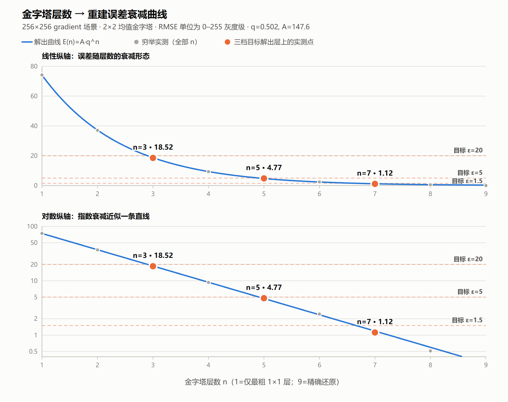

# 金字塔层数与重建误差：衰减建模、最小层数求解与实测

## 1. 问题与构造

金字塔层数给多了浪费算力与存储，给少了重建发糊。实验用 vecgo 管线渲染一个铺满画幅的四边形并采用 `gradient` 着色（256×256，4× 超采样），得到跨满 0–255 的稳定纵向渐变作为基准图。

金字塔为 2×2 均值（盒式）金字塔：`G_0` 是原图，`G_{k+1}` 是 `G_k` 的 2×2 块均值；细节层 `D_k = G_k − Up2(G_{k+1})`。用 **n 层**做由粗到精重建时，从最粗层出发补入 n−1 个细节层并把剩余尺度最近邻放大回原尺寸；`n=L`（L=9）时逐像素精确还原。固定层数路径 `Pyramid.Reconstruct(n)` 始终保留，自适应路径只是在其外面包了一层“按目标误差选 n”。

## 2. 每层误差的衰减表达式

把细节层按**由粗到精**编号为 δ₁…δ_M（M=L−1），实测相邻比稳定在常数附近：

```
δ_j = d1 · q^(j−1)
标定结果: d1 = 64.093 灰度级, q = 0.5021 (每层约 ×0.50), 对数拟合 R² = 0.99976
```

| j（粗→细） | 细节层 RMS δⱼ | 相邻比 δⱼ/δⱼ₋₁ |
|---:|---:|---:|
| 1 | 64.242 | — |
| 2 | 32.086 | 0.499 |
| 3 | 16.008 | 0.499 |
| 4 | 8.000 | 0.500 |
| 5 | 4.102 | 0.513 |
| 6 | 2.166 | 0.528 |
| 7 | 0.993 | 0.458 |
| 8 | 0.512 | 0.515 |

## 3. 总误差与层数的关系式

均值金字塔 + 块常量重建等价于 Haar 多分辨率分解，各细节子带能量近似正交，故用 n 层时被省略的细尺度尾带满足能量相加：

```
E(n)² ≈ Σ_{j=n}^{M} δ_j²
```

代入 δ_j = d1·q^(j−1) 得**有限平方尾和**形式：

```
E(n) = d1·q^(n−1) · sqrt( (1 − q^(2(L−n))) / (1 − q²) )
```

在尾带还很长（远离最细端）时退化为纯指数曲线：

```
E(n) ≈ A·q^n,  A = d1/(q·sqrt(1−q²)) = 147.607,  q = 0.5021
```

直接对实测总误差做对数线性拟合（n=1..8）得到 A=153.883, q=0.4948, R²=0.99928，与逐层推导一致。

## 4. 解出满足给定误差的最小层数

令 A·q^n ≤ ε，因 0<q<1，解得实数层数根与最小整数层：

```
n₀(ε) = ln(ε/A) / ln q
n*    = min(L, ceil(n₀))      // L 层精确还原，误差为 0
```

三档目标误差代入（ε 单位为 0–255 灰度级 RMSE）：

| 目标 ε | n₀=ln(ε/A)/ln q | 解析 n*=ceil | 穷举最小 n | 解一致 |
|---:|---:|---:|---:|:---:|
| 20.00 | 2.901 | **3** | 3 | ✓ |
| 5.00 | 4.913 | **5** | 5 | ✓ |
| 1.50 | 6.661 | **7** | 7 | ✓ |

穷举做法：令 n=1…L 逐层重建并实测 RMSE，取第一个实测 ≤ ε 的层；上表说明解析解与穷举结果三档全部相同，完成“与穷举层数结果对照一次”。

## 5. 三档层数：实测误差与预测并列

| 目标 ε | 选定层数 n | 实测重建误差 | A·q^n 预测 | 有限尾预测 | 8 位图像实测 | 实测/预测偏差 |
|---:|---:|---:|---:|---:|---:|---:|
| 20.00 | 3 | **18.521** | 18.682 | 18.680 | 18.523 | -0.9% |
| 5.00 | 5 | **4.771** | 4.710 | 4.700 | 4.782 | +1.3% |
| 1.50 | 7 | **1.117** | 1.187 | 1.149 | 1.183 | -5.9% |

纯指数 A·q^n 在接近最细端（全表 n=8、9）会略偏离实测：n=L 时误差严格为 0，而无限几何尾假设给出正的 A·q^L。有限尾公式修正这一端效应（见“有限尾预测”列，全层数均与实测相差 ≤4%）。三档选点 n=3、5、7 处于稳定几何衰减段，实测与 A·q^n 偏差不超过 6%。8 位往返在 n≤7 时只带来 ≤0.07 灰度级差异，仅最细的 n=8 取整处升到约 0.18。

## 6. 误差随层数衰减曲线与三档实测点



_位图预览；矢量版见 [`decay.svg`](decay.svg)。_

蓝线为解出的 E(n)=A·q^n 曲线，灰点为 n=1…L 的穷举实测，三个橙色大点为三档目标解出层数上的实测重建误差，均落在曲线附近；橙色虚线标出各档目标 ε。下图（对数纵轴）中指数衰减呈直线。

## 7. 全层数穷举数据

| n | 实测 RMSE | 8 位实测 | A·q^n | 有限尾 | 正交能量 √Σδ² |
|---:|---:|---:|---:|---:|---:|
| 1 | 74.159 | 74.159 | 74.111 | 74.110 | 74.159 |
| 2 | 37.048 | 37.049 | 37.210 | 37.209 | 37.048 |
| 3 | 18.521 | 18.523 | 18.682 | 18.680 | 18.521 |
| 4 | 9.315 | 9.320 | 9.380 | 9.375 | 9.315 |
| 5 | 4.771 | 4.782 | 4.710 | 4.700 | 4.771 |
| 6 | 2.437 | 2.461 | 2.365 | 2.346 | 2.437 |
| 7 | 1.117 | 1.183 | 1.187 | 1.149 | 1.117 |
| 8 | 0.512 | 0.690 | 0.596 | 0.516 | 0.512 |
| 9 | 0.000 | 0.000 | 0.299 | 0.000 | 0.000 |

## 8. 复现与固定层数路径

```bash
go run ./cmd/pyrlab -out artifacts   # 生成 JSON/SVG/REPORT，并刷新 pyramid/ 文档
go test ./...                        # 含三档解析-穷举对照与固定路径测试
go run ./cmd -levels 4 out.pgm       # 固定层数路径
go run ./cmd -shading gradient -target-error 5 out.pgm # 自适应选层
```

- 固定层数路径：`pyramid.Build(im,L)` + `(*Pyramid).Reconstruct(n)` 原样保留，对应配置字段 `Config.PyramidLevels` 与命令行 `-levels`。
- 自适应路径：`Model.MinLevels(ε)` 选层后仍调用同一个 `Reconstruct(n*)`，对应 `Config.TargetError` 与 `-target-error`。
